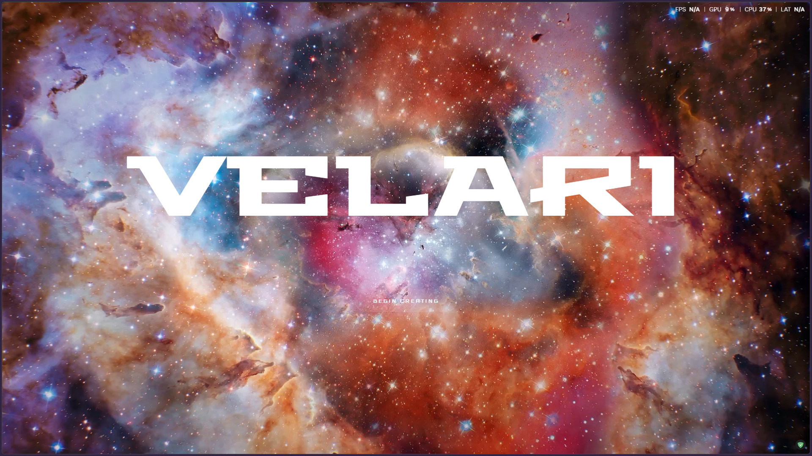
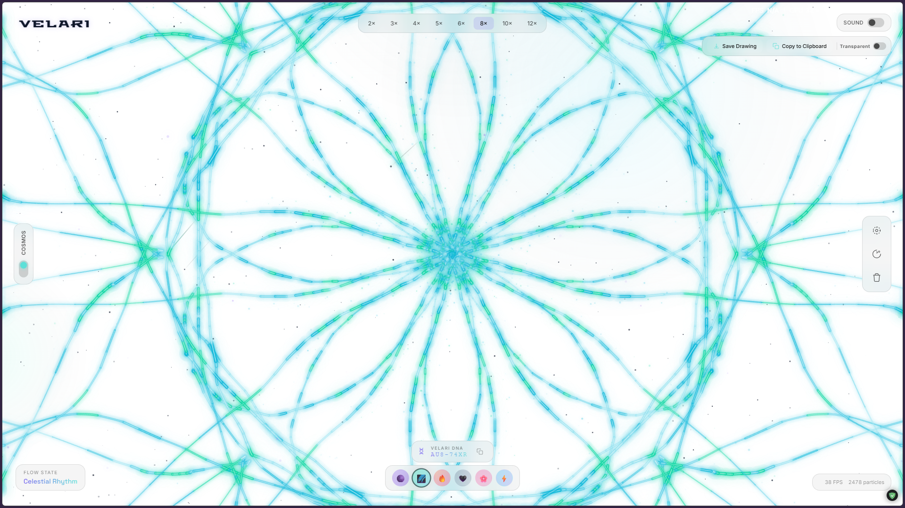
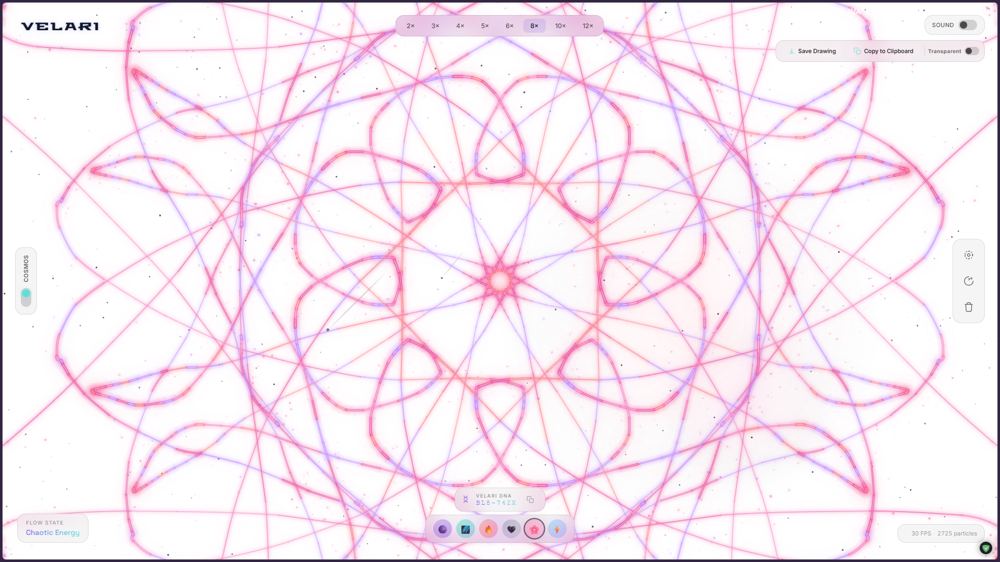
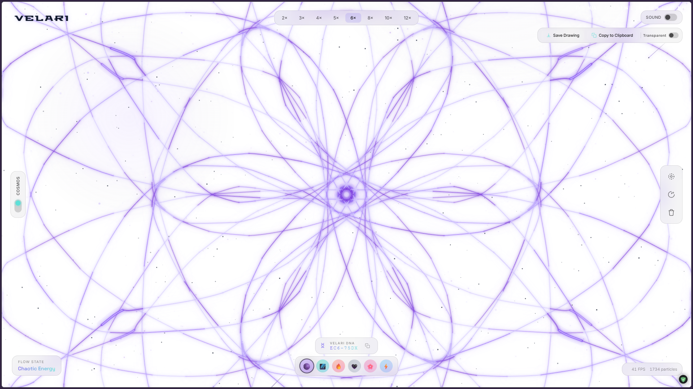
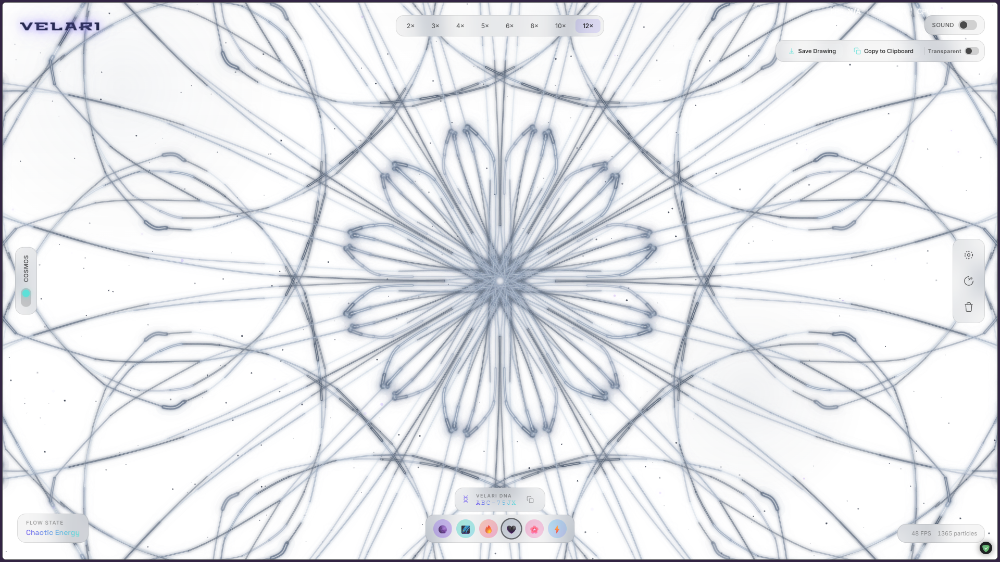
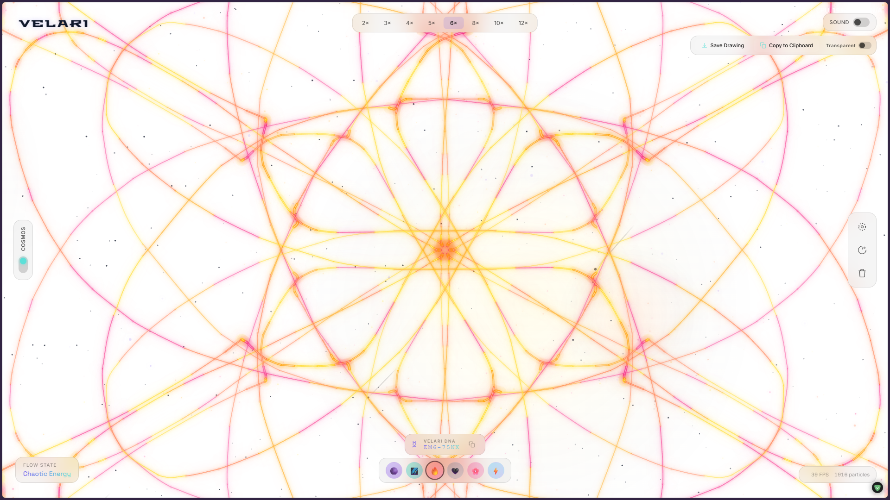

<div align="center">



<br />

# V E L A R I

### YOUR IMAGINATION. AN INFINITE CANVAS.

**An immersive generative-art playground built around colour, motion, creativity, and expressive digital experiences.**

<br />

<a href="https://velari-dusky.vercel.app/">
  
</a>
<a href="https://github.com/septilex/Velari">
  
</a>

<br /><br />


<br /><br />

*Not just another interface. A space to explore, experiment, and create.*

</div>

---

## ◈ Inside Velari

Velari is a creative digital experience that brings together an immersive interface, expressive colour palettes, and motion-driven design in one cohesive environment.

Designed to make digital exploration feel intuitive and visually engaging, Velari moves beyond conventional web layouts to create an experience that feels dynamic, responsive, and distinctly its own.

From its atmospheric presentation to its range of visual themes, every element contributes to a simple idea:

> **The web should be more than something you browse. It should be something you experience.**

### What defines Velari?

| ✦ Visual Expression                                                          | ◉ Interactive Design                                                               | ◈ A Cohesive Experience                                                        |
| :--------------------------------------------------------------------------- | :--------------------------------------------------------------------------------- | :----------------------------------------------------------------------------- |
| A distinctive visual identity built around colour, contrast, and atmosphere. | Responsive interactions, smooth transitions, and motion-focused interface details. | Thoughtful presentation, consistent styling, and a modern frontend experience. |

---

## 🎨 Explore the Visual Universe

Six visual variations. Six different moods. One creative identity.

Velari's colour themes explore different visual personalities, ranging from vibrant neon aesthetics to cleaner, brighter interfaces.

<div align="center">

### 01 — CYAN

*Electric. Atmospheric. Futuristic.*



<br /><br />

### 02 — PINK

*Expressive. Vibrant. Unapologetic.*



<br /><br />

### 03 — PURPLE

*Dreamlike. Experimental. Otherworldly.*



<br /><br />

### 04 — LIGHT

*Minimal. Refined. Effortlessly clear.*



<br /><br />

### 05 — YELLOW AFTER DARK

*Bold. Atmospheric. High contrast.*


<br /><br />

### 06 — YELLOW

*Warm. Energetic. Distinctive.*



</div>

---

## ✨ Features

### Immersive Interface

* A distinctive, modern visual identity.
* Carefully designed layouts and interface components.
* Atmospheric styling with attention to spacing, typography, and contrast.
* An experience designed to feel engaging rather than static.

### Colour & Customisation

* Multiple visual theme variations.
* Distinct colour palettes with their own personalities.
* Dark and light visual directions.
* A consistent design language across the experience.

### Motion & Interaction

* Smooth interface transitions.
* Motion-focused visual details.
* Responsive interaction patterns.
* Micro-interactions that bring the interface to life.

### Modern Frontend Engineering

* Component-based interface architecture.
* Responsive design principles.
* A modern development and build workflow.
* A foundation for continued experimentation and future enhancements.

---

## 🛠️ Technology Stack

Velari brings together modern web technologies to create its frontend experience and visual presentation.

<div align="center">

| Category                     | Technologies              |
| :--------------------------- | :------------------------ |
| **Frontend**                 | React · TypeScript · Vite |
| **Styling**                  | Tailwind CSS              |
| **Animation & Motion**       | Framer Motion · GSAP      |
| **3D & Visual Rendering**    | Three.js                  |
| **Server-side Technologies** | Node.js · Express         |
| **Version Control**          | Git · GitHub              |
| **Deployment**               | Vercel                    |

</div>

---

## 🚀 Run Velari Locally

Want to explore the project, experiment with the interface, or contribute to its development? Get started in a few steps.

### Prerequisites

Make sure you have the following installed:

* [Node.js](https://nodejs.org/)
* npm
* [Git](https://git-scm.com/)

### 01. Clone the repository

```bash
git clone https://github.com/septilex/Velari.git
```

### 02. Enter the project directory

```bash
cd Velari
```

### 03. Install dependencies

```bash
npm install
```

### 04. Start the development server

```bash
npm run dev
```

Open the local URL displayed in your terminal to experience Velari in your browser.

### Build for production

To generate an optimised production build:

```bash
npm run build
```

If the project defines a preview script, preview the generated build locally:

```bash
npm run preview
```

---

## 📁 Project Structure

The relevant project structure is organised as follows:

```text
Velari/
│
├── public/
│   ├── assets/
│   │   ├── homepage.png
│   │   ├── Cyan.png
│   │   ├── pink.png
│   │   ├── purple.png
│   │   ├── White.png
│   │   ├── yellow dark.png
│   │   └── yellow.png
│   │
│   └── videos/
│
├── src/
│
├── index.html
├── package.json
├── package-lock.json
├── tsconfig.json
├── vite.config.ts
└── README.md
```

*The tree highlights the relevant files and folders; your repository may contain additional assets and source files.*

---

## 🧭 What's Next?

Velari is a foundation for continuous creative exploration. Potential directions for further development include:

* [ ] Expand the collection of generative visual experiences.
* [ ] Introduce deeper user-controlled visual customisation.
* [ ] Explore richer 3D scenes and WebGL-based effects.
* [ ] Refine accessibility and responsiveness across devices.
* [ ] Continue improving rendering performance and interaction quality.
* [ ] Experiment with AI-assisted creative tools and personalised experiences.

---

## 🤝 Contributing

Creative ideas, constructive feedback, and meaningful improvements are welcome.

To contribute:

1. Fork the repository.
2. Create a feature branch.
3. Implement and test your changes.
4. Commit your work with a descriptive message.
5. Open a pull request explaining your contribution.

For substantial changes, consider opening an issue first to discuss the proposed direction.

---

## ⭐ Support the Project

If you enjoy Velari, consider visiting the live experience, exploring the source code, or starring the repository on GitHub.

Every bit of feedback helps the project continue to evolve.

<br />

<div align="center">

## MADE WITH CURIOSITY.

### Built by Prajit & Harshitha

**Prajit Balaji K**

<a href="https://www.linkedin.com/in/prajit-balaji-kalidindi-2b706a36a/">LinkedIn</a>
  ·   <a href="mailto:mranimemusic111999@gmail.com">Email</a>
  ·   <a href="https://velari-dusky.vercel.app/">Live Experience</a>
  ·   <a href="https://github.com/septilex/Velari">GitHub</a>

<br />

*“Design the future. Build the impossible.”*

<br />


</div>
